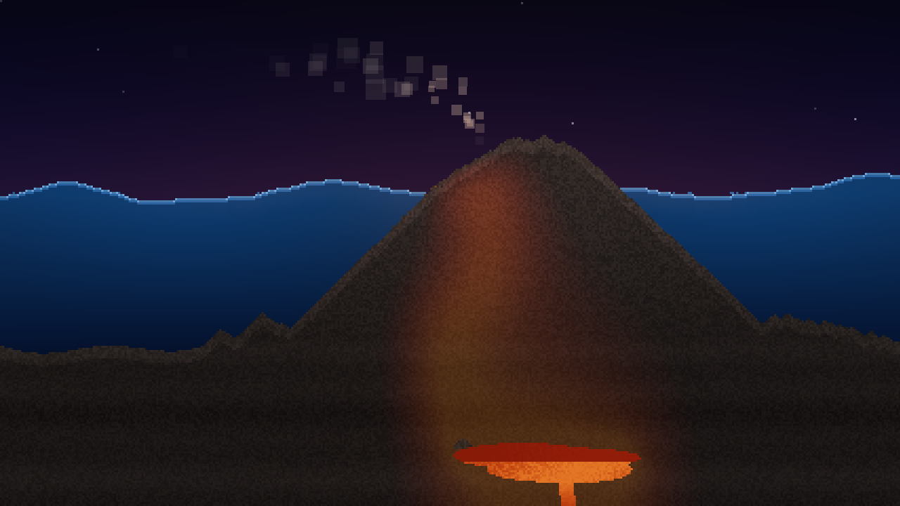

# toastsaver

Retro screensavers for Raspberry Pi OS and other Wayland desktops: flying toasters, a rainbow waffle cat, 3D pipes, a cozy bookshelf, birds in a summer sky and more, with a big friendly picker that a six-year-old can use.


```sh
curl -fsSL https://piyh.github.io/toastsaver/setup.sh | sh
```

## What's inside

Thirteen screensavers, plus a SURPRISE ME button that picks a random one each time from the ones you put in the mix. All of the artwork is original and drawn by the program itself.

<table>
  <tr>
    <td align="center"><br><b>TOASTERS</b></td>
    <td align="center"><br><b>RAINBOW</b></td>
  </tr>
  <tr>
    <td align="center"><br><b>PIPES</b></td>
    <td align="center"><br><b>BOOKS</b></td>
  </tr>
  <tr>
    <td align="center"><br><b>DICE</b></td>
    <td align="center"><br><b>FISH</b></td>
  </tr>
  <tr>
    <td align="center"><br><b>BIRDS</b></td>
    <td align="center"><br><b>STARS</b></td>
  </tr>
  <tr>
    <td align="center"><br><b>MYSTIFY</b></td>
    <td align="center"><br><b>MATRIX</b></td>
  </tr>
  <tr>
    <td align="center"><br><b>LAVA</b></td>
    <td align="center"><br><b>NAME</b></td>
  </tr>
  <tr>
    <td align="center" colspan="2"><br><b>VOLCANO</b></td>
  </tr>
</table>

- **TOASTERS**: winged chrome toasters and slices of toast flying down and to the left.
- **RAINBOW**: the Waffle Cat flies across the night sky on a wavy rainbow. Every so often it shimmers, goes *poof*, rainbow lines zoom across the screen, and it pops back out at the end of the rainbow. (Invented by a six-year-old.)
- **PIPES**: shiny 3D pipes grow through a grid, then fade and start again.
- **BOOKS**: a cozy lamplit bookshelf. Books slide out, float to the middle, open to a little animated picture, and fly back to their spot.
- **DICE**: 3D dice (d6, d8, d10, d12 and d20) are thrown together onto a felt tray. Then each number flies up to a chalkboard, slowly enough for a kid to add them up first. A natural 20 on the d20 gets gold rays, confetti and "CRIT!"; a natural 1 gets a grumpy rain cloud.
- **FISH**: clownfish, a blue tang, a pufferfish, seaweed and a bubbling treasure chest.
- **BIRDS**: a sunny summer sky with bluebirds, cardinals, finches and robins flying over a flower meadow, visited by butterflies, bees and ladybugs. (Also requested by a six-year-old.)
- **STARS**: a warp-speed starfield.
- **MYSTIFY**: bouncing, color-changing shapes with echo trails.
- **MATRIX**: falling green code. Sometimes a column spells your name.
- **LAVA**: a glowing lava lamp with wax that warms, rises, merges and sinks, in a new color each time.
- **VOLCANO**: a night-time island volcano. Lava oozes and erupts, flows down the slopes and cools into rock so the mountain slowly grows, and hisses into steam where it reaches the sea. Smoke, ash, flying fire-bombs and rock chunks fill the sky. When it gets tall it blows up and a new island begins.
- **NAME**: your name bounces around like the old DVD logo, with confetti when it hits a corner.

### Easter eggs

Keep watching the toasters. Every so often a toaster flies by in a **propeller beanie**, a **golden toast** sparkles past, or a **bagel** sneaks in with the toast.

## Install

### Raspberry Pi OS, Debian and Ubuntu (64-bit, 32-bit Pi and x86)

```sh
curl -fsSL https://piyh.github.io/toastsaver/setup.sh | sh
```

[`setup.sh`](site/setup.sh) adds the toastsaver APT repository and installs the package. If you'd rather not pipe a script into your shell, these four lines do the same thing:

```sh
sudo install -d -m 0755 /etc/apt/keyrings
curl -fsSL https://piyh.github.io/toastsaver/toastsaver.gpg | sudo tee /etc/apt/keyrings/toastsaver.gpg >/dev/null
echo "deb [signed-by=/etc/apt/keyrings/toastsaver.gpg] https://piyh.github.io/toastsaver stable main" | sudo tee /etc/apt/sources.list.d/toastsaver.list
sudo apt update && sudo apt install toastsaver
```

Updates then arrive with your normal system updates (`sudo apt update && sudo apt upgrade`, or the updater in the Raspberry Pi OS taskbar). You can also download a `.deb` from the [releases page](https://github.com/piyh/toastsaver/releases) and install it with `sudo apt install ./toastsaver_*.deb`.

### Arch Linux

A [`PKGBUILD`](packaging/aur/PKGBUILD) is included. Build it with `makepkg -si` from that folder. An AUR package is coming.

### From source

```sh
sudo apt install build-essential pkg-config libsdl2-dev swayidle
git clone https://github.com/piyh/toastsaver.git
cd toastsaver
make && sudo make install
toastsaver --desktop-icon            # optional: a Screensavers icon on the desktop
```

This installs under `/usr/local`. `wlopm` (if your distribution has it) lets toastsaver turn the display off after a while.

### After installing

Log out and back in (or run `toastsaver-idle --restart`). The screensaver now starts by itself whenever the computer has been idle for 5 minutes.

## Using it

### The app

Open **Screensavers** from the app menu. To put an icon on the desktop too, run `toastsaver --desktop-icon`. The front page is made for kids; the settings are one step behind it.


- **Tap a tile** to choose it. Your choice is saved right away. There is no Save button.
- **Tap the chosen tile again**, or the big green **TRY IT!** button, to watch it.
- **Move the mouse, touch the screen, or press any key** to go back to the picker.
- **SURPRISE ME!** (under the tiles) shows a different saver each time. While it is on, the tiles show which savers are **in the mix**: tap a tile to put it in (green check) or take it out (dimmed). At least one always stays in. Tap **SURPRISE ME!** again to turn it off and choose a single tile.
- **VOLCANO**: a night-time island volcano. Lava oozes and erupts, flows down the slopes and cools into rock so the mountain slowly grows, and hisses into steam where it reaches the sea. Smoke, ash, flying fire-bombs and rock chunks fill the sky. When it gets tall it blows up and a new island begins.
- **NAME**: when it is chosen, type your name on the keyboard.
- The **big red X** closes the app.

On a keyboard, use the arrow keys to move, **Enter** to try, **Tab** to turn SURPRISE ME on or off, **Space** to put the highlighted saver in or out of the mix, and **Esc** to close.

### Settings (for grown-ups)

Click the **gear** in the top-left corner of the app. Changes are saved right away, and new timings take effect as soon as you go back.


- **Screensaver**: turn it on or off.
- **Start after**: how long the computer waits before showing the screensaver.
- **Screen off after**: when the display turns off, or **NEVER**. It is always later than the screensaver.
- **Show clock**: puts the time over any screensaver. It drifts to a new spot about once a minute, so it never sits in one place.
- **Clock style**: 12-hour or 24-hour.
- **Save power**: draws savers at 30 frames a second instead of as fast as the display can, which roughly halves the work and looks the same for these savers. On by default.
- **Test it** shows the current screensaver; **Back** returns to the tiles.


### Commands

| Command | What it does |
| --- | --- |
| `toastsaver-picker` | Open the app |
| `toastsaver-settings` | Same as `toastsaver-picker` (kept for older menus) |
| `toastsaver-idle --now` | Show your chosen saver now |
| `toastsaver-idle --now pipes` | Show a specific saver now |
| `toastsaver-idle --check` | Check that everything is set up and running |
| `toastsaver-idle --restart` | Apply new settings now |
| `toastsaver --set CLOCK=1` | Change any setting from a terminal |
| `toastsaver --list` | List the saver names |
| `toastsaver --desktop-icon` | Put a Screensavers icon on the desktop |
| `toastsaver --windowed toasters` | Run a saver in a window |

See `man toastsaver` for everything.

### Settings file

Settings live in `~/.config/toastsaver.conf`. The app edits it for you and keeps your comments.

```sh
ENABLED=1               # 0 = turn the screensaver off
SAVER=toasters          # toasters rainbow pipes books dice aquarium birds starfield mystify matrix lava volcano name random
RANDOM_SAVERS=          # savers SAVER=random picks from, e.g. toasters,pipes,lava (empty = all)
NAME='HELLO'            # letters, digits, space and ! ? - . *  (* draws a heart)
IDLE_MINUTES=5          # minutes of no input before the screensaver appears
SCREEN_OFF_MINUTES=30   # minutes before the display turns off (0 = never)
CLOCK=0                 # 1 = show a drifting clock over the screensaver
CLOCK_24H=0             # 1 = 24-hour clock
FPS=30                  # frames per second; 30 saves power, 0 = as fast as the display
```

## How it works

At login, every user's session starts `toastsaver-idle` from `/etc/xdg/autostart`. It runs [`swayidle`](https://github.com/swaywm/swayidle), which watches for inactivity:

- After `IDLE_MINUTES` with no input, the chosen saver starts full screen.
- Any key, click, touch or mouse movement makes it go away.
- After `SCREEN_OFF_MINUTES`, the display turns off with `wlopm`, if it is installed.

toastsaver never stops the screen from blanking. Apps that block idle the standard Wayland way (the idle-inhibit protocol, which video players and games use while playing) keep the saver from starting.

It is not a lock screen.

## Supported desktops

| Desktop | Status |
| --- | --- |
| labwc (Raspberry Pi OS default) | Tested |
| sway | Tested |
| Wayfire (older Raspberry Pi OS) | Should work, untested |
| Hyprland, river and other wlroots desktops | Should work, untested |
| GNOME, KDE Plasma | Not supported (they use their own idle systems) |
| X11 sessions | Not supported (toastsaver quietly does nothing) |

Tested on a **Raspberry Pi 4 (4 GB) with 64-bit Raspberry Pi OS**, and in Debian trixie and bookworm containers on every change. Only the first monitor is used, and the 3D pipes run best on a Raspberry Pi 4 or 5.

## Uninstall

```sh
sudo apt remove toastsaver       # keeps the autostart file in /etc (it is ignored)
sudo apt purge toastsaver        # removes everything except your ~/.config/toastsaver.conf
```

For a source install, run `sudo make uninstall` in the source folder.

## Development

You need SDL2 (2.0.18 or newer) and `pkg-config`. Then run `make`. On macOS, `brew install sdl2` and run savers with `--windowed`.

Render a frame without a display:

```sh
toastsaver --snapshot out.png --size 1280x720 --seconds 5 pipes
```

### Tests

[`tests/pi-os-test.sh`](tests/pi-os-test.sh) runs in a throwaway Debian container (the base of Raspberry Pi OS). It installs toastsaver, from source or from a `.deb`, starts a headless compositor (labwc on trixie, sway on bookworm), and checks that:

1. a saver appears after the idle timeout and leaves on a key press,
2. an app that inhibits idle (like a playing video) stops it from starting, and it starts again once that app closes,
3. dismissing a saver that pops up over the picker leaves the picker open,
4. `toastsaver-idle --now pipes` starts that saver,
5. settings: `--set` keeps the file's comments, `--restart` switches to the new timings, `ENABLED=0` stops the watcher, the app opens and a saver runs with the clock on,
6. for the `.deb`: `apt remove` and `apt purge` clean up.

`make check` adds a quick check of the dice geometry that needs no display.

[`tests/run.sh`](tests/run.sh) runs it all in parallel, in prepared Docker images ([`tests/Dockerfile`](tests/Dockerfile)) so nothing is downloaded during a run:

```sh
sh tests/run.sh          # about 30 s: from source on trixie and bookworm, plus the native .deb
sh tests/run.sh full     # also the .deb on bookworm and the emulated armhf/amd64 packages (minutes)
```

The first run builds the images, which takes a few minutes; later runs reuse them. The suite also runs on a plain image, which is what CI does: `docker run --rm -v "$PWD":/src debian:trixie sh /src/tests/pi-os-test.sh`. To build a package by itself: `sh packaging/build-deb.sh arm64` (or `armhf`, `amd64`) writes `dist/toastsaver_<version>_<arch>.deb`.

Before every push, a git hook runs the quick tests. Turn it on once per clone with `git config core.hooksPath .githooks`; skip it for one push with `git push --no-verify`.

### Releases

Releases are made from a developer machine; no CI service is involved. Add a `debian/changelog` entry, bump `VERSION` in `src/engine.h` and the version in `man/toastsaver.1`, commit, then:

```sh
sh packaging/release.sh --dry-run    # everything short of publishing (about 90 s)
sh packaging/release.sh              # publish
```

[`packaging/release.sh`](packaging/release.sh) runs the full tests (which build the three packages) and builds the Mac app. It then tags and pushes, creates the GitHub release with `gh`, builds and signs the APT repository in a throwaway container and pushes it to the `gh-pages` branch (served by GitHub Pages), and updates the AUR checksum. Finally it checks a fresh install and an upgrade against the live repository. It needs Docker, `gh` signed in, and the APT signing key in a local file (`TOASTSAVER_SIGNING_KEY`) or from a command such as a password manager's CLI (`TOASTSAVER_SIGNING_KEY_CMD`).

## About

Made by a parent for a six-year-old who loves screensavers.

toastsaver was written with the help of an AI assistant (Claude). It is tested on real hardware and by an automated end-to-end suite, and every line is in this repository to read. Bug reports and pull requests are welcome.

## License

MIT. See [`LICENSE`](LICENSE).
